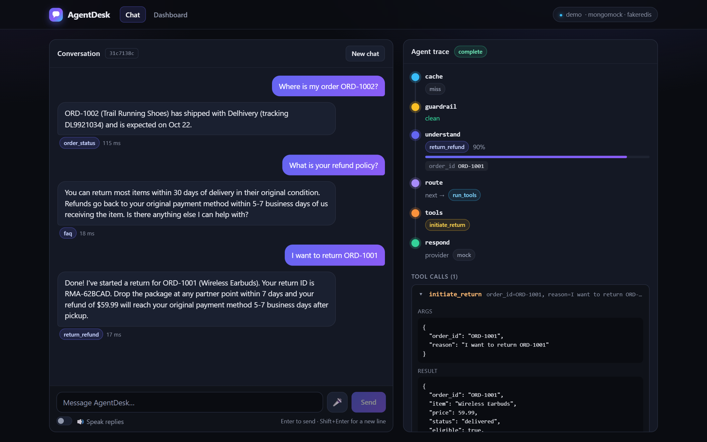
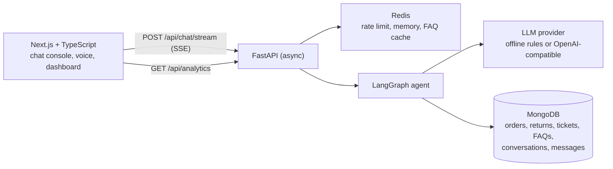
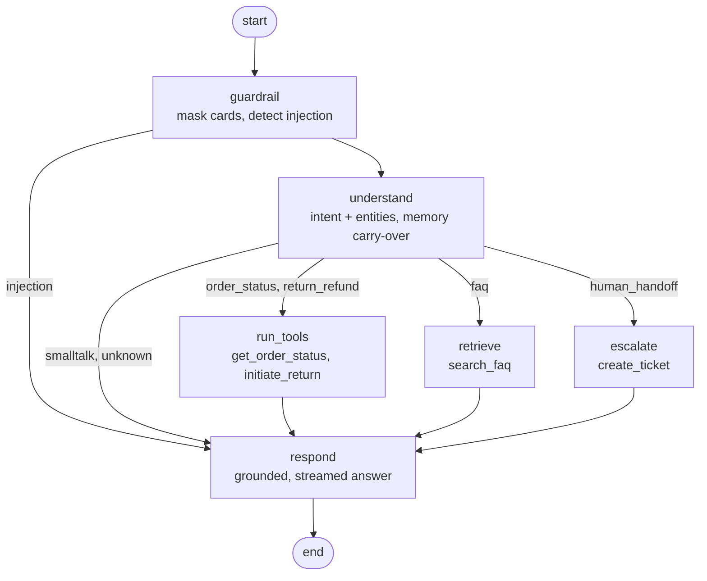

# AgentDesk — AI Customer-Support Agent (chat + voice)

[](https://github.com/Pinned-Knight/AgentDesk/actions/workflows/ci.yml)


**A full-stack AI support agent.** A Next.js/TypeScript console streams answers from a FastAPI backend that runs a
**LangGraph** workflow over **MongoDB**-backed business tools, with **Redis** for conversation memory, response caching
and rate limiting — plus browser voice input/output and a live analytics dashboard.



## What it does

A customer talks (or speaks) to the agent; the agent decides what to do and shows its work in real time:

- **Tracks orders** — looks the order up in MongoDB and explains the status.
- **Handles returns** — checks the 30-day policy window, creates an idempotent return request (RMA) or explains why not.
- **Answers policy questions** — retrieves the best FAQ entries from MongoDB and grounds the reply in them.
- **Escalates to a human** — opens a priority ticket when asked or when the customer is upset.
- **Remembers context** — "I want to return *it*" resolves to the order mentioned earlier in the session (Redis memory).
- **Protects itself and the customer** — Luhn-validated card numbers are masked before anything is stored; prompt-injection attempts are refused without ever reaching the LLM.

Every turn streams a **trace** (guardrail → understand → route → tools → respond) and **tool calls** to the UI over
server-sent events, token by token.

## Architecture



### The agent workflow (LangGraph)



Nodes push `trace`, `tool` and `token` events through an emitter passed in the run config, so one compiled graph serves
both the JSON endpoint and the SSE endpoint.

## Tech stack

| Layer | Choices |
|---|---|
| Frontend | Next.js (App Router), React, TypeScript (strict), hand-written CSS, Web Speech API for voice |
| API | Python 3.11, FastAPI, async everywhere, Pydantic v2 models, SSE streaming |
| Agent | LangGraph state machine with conditional routing; provider-agnostic LLM layer |
| Data | MongoDB via Motor (orders, returns, tickets, FAQs, conversations, messages); aggregation pipelines for analytics |
| Cache / state | Redis (`redis.asyncio`): per-session memory, FAQ response cache, fixed-window rate limiter |
| Quality | 74 pytest tests, GitHub Actions CI (in-memory *and* real MongoDB + Redis service containers), docker-compose smoke test |

## Quickstart (no API keys, no databases)

The default **demo mode** runs everything in-process: an offline deterministic LLM provider, `mongomock` for MongoDB
and `fakeredis` for Redis — so the whole product works out of the box.

```bash
# 1. API  (http://localhost:8000, docs at /docs)
cd backend
python -m venv .venv && source .venv/bin/activate      # Windows: .venv\Scripts\activate
pip install -r requirements-dev.txt
uvicorn app.main:app --port 8000

# 2. UI   (http://localhost:3000)
cd frontend
npm install
npm run dev
```

Try: *"Where is my order ORD-1002?"*, *"I want to return ORD-1001"*, *"What is your refund policy?"*,
*"I'd like to speak to a human"* — or click the 🎤 and say it. Sample orders `ORD-1001`…`ORD-1008` cover every
lifecycle state (delivered, shipped, processing, out for delivery, cancelled, outside the return window).

Fill the dashboard with realistic traffic: `python scripts/simulate_traffic.py --rounds 3`

### Full stack with real MongoDB + Redis

```bash
docker compose up --build        # UI :3000, API :8000, MongoDB 7, Redis 7
```

### Live LLM mode

Any OpenAI-compatible `/chat/completions` endpoint works (OpenAI, Gemini, Groq, Ollama, vLLM…):

```bash
export LLM_PROVIDER=openai_compat
export LLM_API_KEY=sk-...
export LLM_MODEL=gpt-4o-mini
# export LLM_BASE_URL=https://generativelanguage.googleapis.com/v1beta/openai   # Gemini
# export LLM_BASE_URL=http://localhost:11434/v1                                  # Ollama (no key needed)
```

In live mode the model does intent classification (JSON mode) and writes the streamed answer, **grounded only in the
tool results and FAQ snippets** passed to it. Tools, retrieval, guardrails, memory, caching and persistence are
identical. If the endpoint errors, the agent degrades to the rule-based classifier and template responder instead of
failing the turn. The provider is covered by tests against a mocked HTTP transport (request shape, JSON-mode retry,
SSE streaming, failure fallback); it has not been benchmarked against a hosted model.

## API

| Method | Path | Purpose |
|---|---|---|
| `POST` | `/api/chat` | One turn, JSON response (`reply`, `intent`, `tools`, `escalated`, `latency_ms`, …) |
| `POST` | `/api/chat/stream` | Same turn as server-sent events: `trace`, `tool`, `token`, `done`, `error` |
| `GET` | `/api/conversations` · `/{session_id}` | Conversation list and full transcript with tool calls |
| `GET` | `/api/analytics` | Intent mix, tool usage, escalation / cache-hit rate, latency, daily volume (MongoDB aggregations) |
| `GET` | `/api/health` | Mode and which Mongo / Redis / LLM backends are active |

```bash
curl -s localhost:8000/api/chat -H 'content-type: application/json' \
  -d '{"session_id":"demo-session-01","message":"I want to return ORD-1001"}'
```

Rate limiting returns `429` with `Retry-After`. Interactive docs: `http://localhost:8000/docs`.

## Design decisions

- **A workflow graph, not a free-form tool loop.** Routing is explicit and auditable, guardrails run *before* any LLM
  call, and each node can narrate itself to the UI. Open-ended tool-calling is a clean extension (see roadmap).
- **The offline provider is a first-class citizen.** It makes the product demoable and fully testable without keys,
  and doubles as the fallback when a remote model fails.
- **Redis does three different jobs, each with the right primitive** — a capped list with TTL for memory, a hashed
  normalised-message key with TTL for the FAQ cache (only answers that were *retrieval-grounded* are cached), and
  `INCR` + `EXPIRE` for a fixed-window rate limiter.
- **Analytics are computed inside MongoDB** (`$group`, `$unwind`, `$dateToString`), not by pulling documents into Python.
- **Idempotent writes.** Asking twice to return the same order returns the existing RMA rather than creating a duplicate.
- **Same tests, two backends.** Exporting `MONGODB_URI` / `REDIS_URL` runs the identical suite against real services;
  CI does exactly that, plus a full `docker compose` smoke test.

## Project structure

```
AgentDesk/
├── backend/
│   ├── app/
│   │   ├── main.py            # app factory + lifespan wiring (Mongo, Redis, LLM, graph)
│   │   ├── config.py          # pydantic-settings, all env-driven
│   │   ├── agent/             # graph.py (LangGraph workflow) · service.py (one turn: cache → graph → persist)
│   │   ├── llm/               # provider protocol · offline rules · OpenAI-compatible streaming client
│   │   ├── tools.py           # order lookup, return eligibility/RMA, FAQ retrieval, tickets
│   │   ├── guardrails.py      # Luhn card masking, prompt-injection detection
│   │   ├── cache.py           # Redis memory, response cache, rate limiter
│   │   ├── db.py · seed_data.py
│   │   └── routes/            # chat (JSON + SSE), conversations, analytics, health
│   └── tests/                 # 74 tests: API, tools, guardrails, LLM provider
├── frontend/                  # Next.js app: chat console, dashboard, SSE client, voice hooks
├── scripts/simulate_traffic.py
├── docker-compose.yml
└── .github/workflows/ci.yml
```

## Tests

```bash
cd backend && pytest -q                                   # in-memory stand-ins
MONGODB_URI=mongodb://localhost:27017 REDIS_URL=redis://localhost:6379/0 pytest -q   # real services
cd frontend && npm run typecheck && npm run build
```

## Roadmap

- Auth and multi-tenant data isolation
- LLM-driven tool-calling loop (LangGraph ReAct) for open-ended requests, alongside the deterministic routes
- Server-side voice pipeline (streaming ASR/TTS with LiveKit Agents or Pipecat) in place of the browser speech APIs
- Postgres analytics warehouse; deploy to AWS/GCP

## License

MIT — see [LICENSE](LICENSE).
